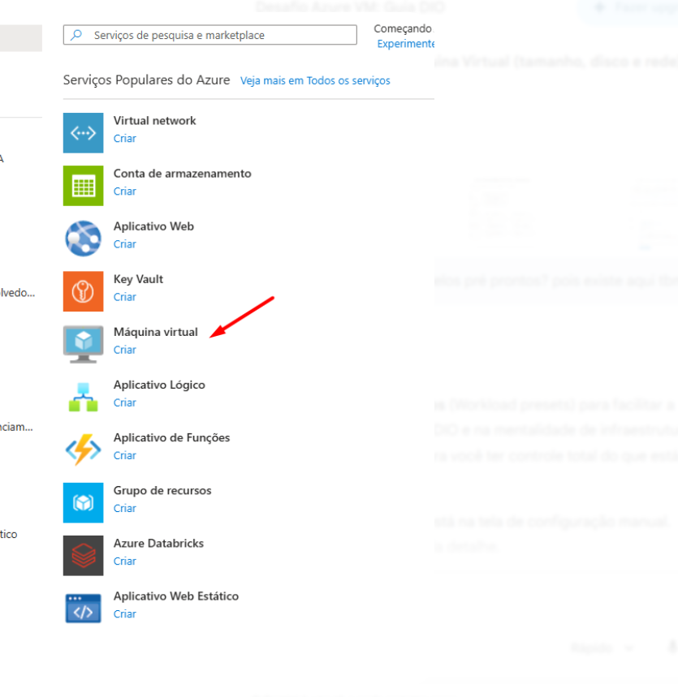

# Laboratório: máquina virtual Linux no Microsoft Azure

> Exercício pessoal de cloud realizado manualmente. Este repositório não contém IaC, scripts de provisionamento ou pipeline de CI/CD; descreve um laboratório, não uma implantação automatizada nem um ambiente de produção.

## Escopo documentado

- Máquina virtual com Ubuntu Server 24.04 LTS.
- Tamanho registrado no exercício: Standard D2s v3.
- Acesso administrativo por SSH e regras de rede associadas à VM.
- Exercício realizado no contexto de um desafio/estudo da DIO.

A região e o escopo exato da regra SSH não são afirmados aqui porque as evidências disponíveis não são consistentes. Também não afirmo que login por senha foi desativado, que recursos são removidos automaticamente ou que a infraestrutura pode ser recriada sem intervenção.

## Evidência

Esta captura genérica é a única imagem mantida na branch atual. As outras capturas foram omitidas por conterem endereços IP, identificadores de assinatura ou nomes de recursos. A remoção da branch atual não apaga versões antigas do histórico Git; uma eventual reescrita do histórico é uma operação separada.

## Segurança e custos

Antes de expor uma VM de laboratório, restrinja SSH no Network Security Group às origens administrativas necessárias; não deixe a porta 22 aberta para qualquer origem. Verifique os recursos públicos e os custos da assinatura e remova recursos que não estejam mais em uso. A exclusão de recursos é destrutiva e deve ocorrer somente depois de confirmar o que será apagado.

As capturas são evidências visuais limitadas: não substituem configuração versionada, logs ou testes reproduzíveis. Não inclua IPs, IDs de assinatura, nomes internos ou credenciais em futuras capturas.
